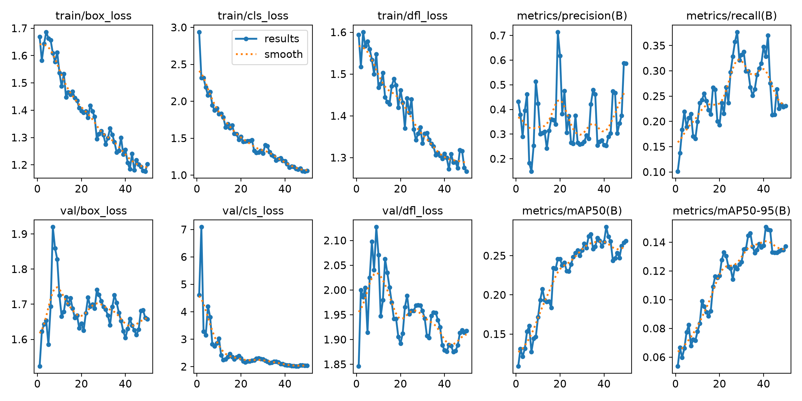

# Дополнительный опыт: более длительное обучение

Изменено только число эпох: 20→50, остальные настройки E2 сохранены. План зафиксирован до запуска в improvement-plan.md. Набор и разбиение неизменны.

|Опыт|Validation mAP50|Validation mAP50-95|
|---|---:|---:|
|E2 (20 эпох)|0.2365|0.1209|
|E3 (50 эпох)|0.2868|0.1507|

Изменение mAP50-95: +0.0298 (+2.98 процентного пункта). Кандидат лучше по зафиксированному validation-критерию.

|Класс|Объекты val|AP50-95 E2|AP50-95 E3|Recall E2|Recall E3|
|---|---:|---:|---:|---:|---:|
|Hardhat|3|0.0863|0.0625|0.3333|0.1028|
|Mask|11|0.3210|0.4792|0.1993|0.6364|
|NO-Hardhat|7|0.0471|0.0522|0.2857|0.2857|
|NO-Mask|3|0.0005|0.0000|0.0000|0.0000|
|NO-Safety Vest|11|0.1565|0.1317|0.4974|0.7887|
|Person|22|0.2823|0.2834|0.4091|0.4545|
|Safety Cone|1|0.0000|0.0000|0.0000|0.0000|
|Safety Vest|4|0.0015|0.0075|0.0000|0.0000|
|machinery|58|0.2761|0.2725|0.5862|0.6552|
|vehicle|3|0.0376|0.2175|0.0000|0.3333|

Исходный отчёт E1/E2 сохранён. Test повторно не оценивался: он уже просмотрен, поэтому для независимого подтверждения улучшения нужна новая тестовая выборка. Разница на одном seed и маленьком validation не является гарантией качества на других камерах. Precision/Recall библиотека считает при пороге, близком к максимуму среднего F1.

Главное оставшееся ограничение — 135 неоднородных обучающих изображений и мало validation-объектов отдельных классов; увеличение эпох не заменяет новые независимые размеченные сцены. Плохие/неоднозначные рамки требуют проверки человеком.

Практическая интерпретация: AP Hardhat снизился 0.0863→0.0625, AP NO-Safety Vest — 0.1565→0.1317. Прирост среднего результата обеспечивают прежде всего Mask и vehicle; это не улучшение всех критичных PPE-классов. Поэтому E3 не объявляется готовой заменой для контроля касок. Следующий приоритет — больше независимых строительных сцен, согласованная разметка отрицательных классов, больше объектов каждого PPE-класса на validation и новая независимая test-выборка.
