# Лабораторная №3: обнаружение СИЗ на YOLOv8

## Постановка и данные

Обнаружение 10 классов СИЗ/людей/техники, YOLOv8n. Цель — воспроизводимое сравнение двух конфигураций; обязательного порога качества в задании нет. Набор 194 изображения: 135 train / 31 validation / 28 test. Происхождение, лицензия, прокси-группы сцен и ограничения описаны в [паспорте](../data/README.md). Test заморожен до обучения; выбор модели выполнен по validation, не по test.

Исходный проект содержит результаты и веса, но не исполняемый код обучения. Исходный best.pt проверен на 5 изображениях, E0 (COCO YOLOv8n) — на 10. Общая COCO-модель обнаруживает людей и общие объекты, но не имеет отдельных PPE-классов; её классы нельзя напрямую сравнивать с PPE AP. Предсказания сохранены в upstream/ и e0/.

## Конфигурации и результаты

E1: 20 эпох, batch=4, imgsz=640, seed=42, AdamW lr0=.001, CPU. E2 меняет только freeze=10. Ресурсные изменения 50→20 эпох и 16→4 batch зафиксированы до сравнения. Гипотеза: заморозка backbone ускорит обучение ценой возможного ухудшения адаптации.

|Опыт|Validation mAP50|Validation mAP50-95|Test mAP50|Test mAP50-95|Обучение, с|
|---|---:|---:|---:|---:|---:|
|e1|0.1851|0.0963|0.3882|0.2050|667.9|
|e2|0.2365|0.1209|0.3968|0.2399|513.5|

Выбрана **e2** по validation mAP50-95. [Фиксация выбора](selection.json). Начальные веса в обоих опытах одинаковы, upstream best.pt не использован.

### e1: test по классам

|Класс|Объекты|Precision|Recall|AP50|AP50-95|
|---|---:|---:|---:|---:|---:|
|Hardhat|32|0.9328|0.6562|0.7971|0.5236|
|Mask|14|0.3693|0.3571|0.3624|0.2045|
|NO-Hardhat|22|0.6086|0.2273|0.5019|0.1788|
|NO-Mask|33|0.6876|0.0303|0.1221|0.0385|
|NO-Safety Vest|25|0.3713|0.5200|0.4875|0.2025|
|Person|57|0.7901|0.6606|0.7827|0.4597|
|Safety Cone|12|0.6657|0.1667|0.4060|0.2426|
|Safety Vest|27|0.4807|0.4074|0.4107|0.1923|
|machinery|1|0.0000|0.0000|0.0000|0.0000|
|vehicle|1|1.0000|0.0000|0.0113|0.0070|

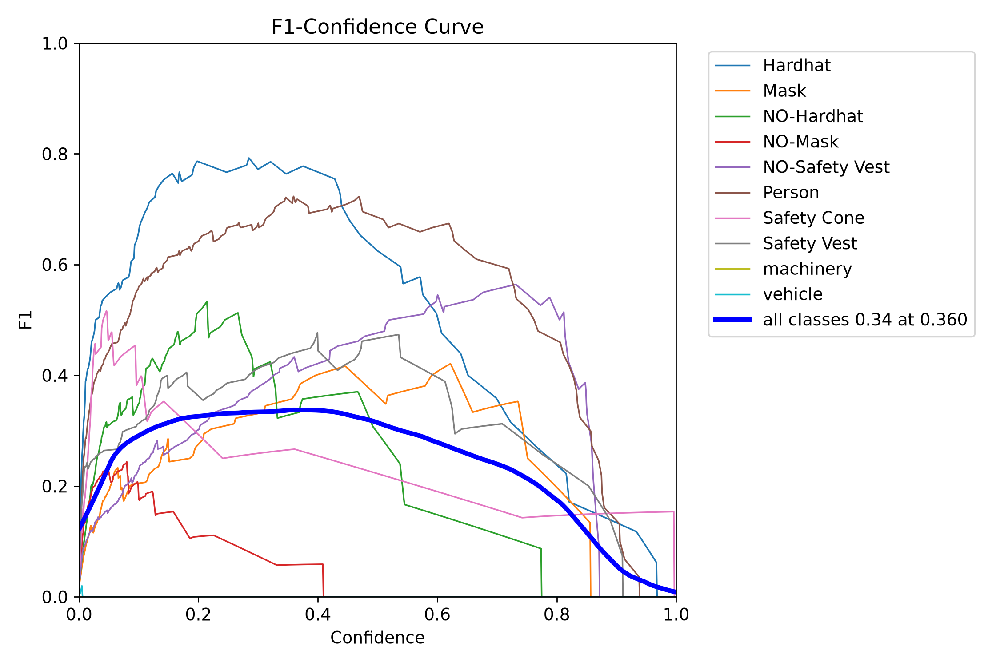

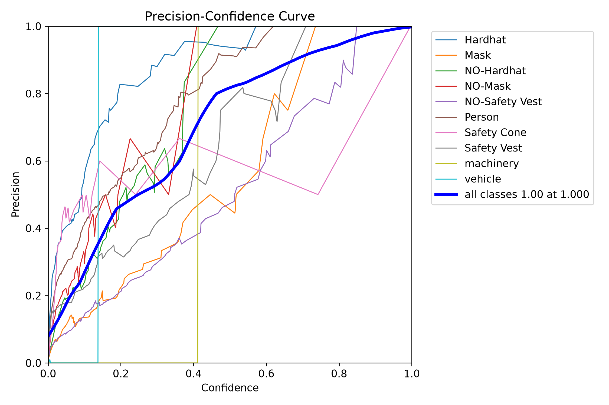

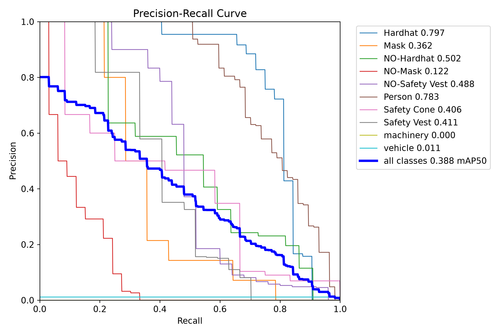

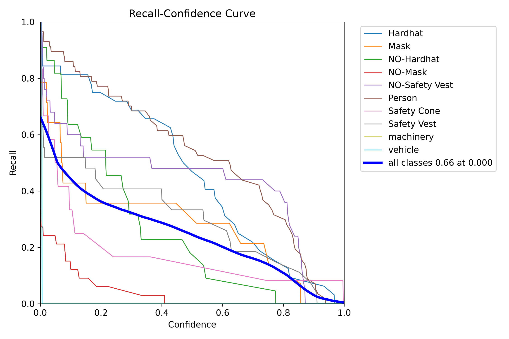

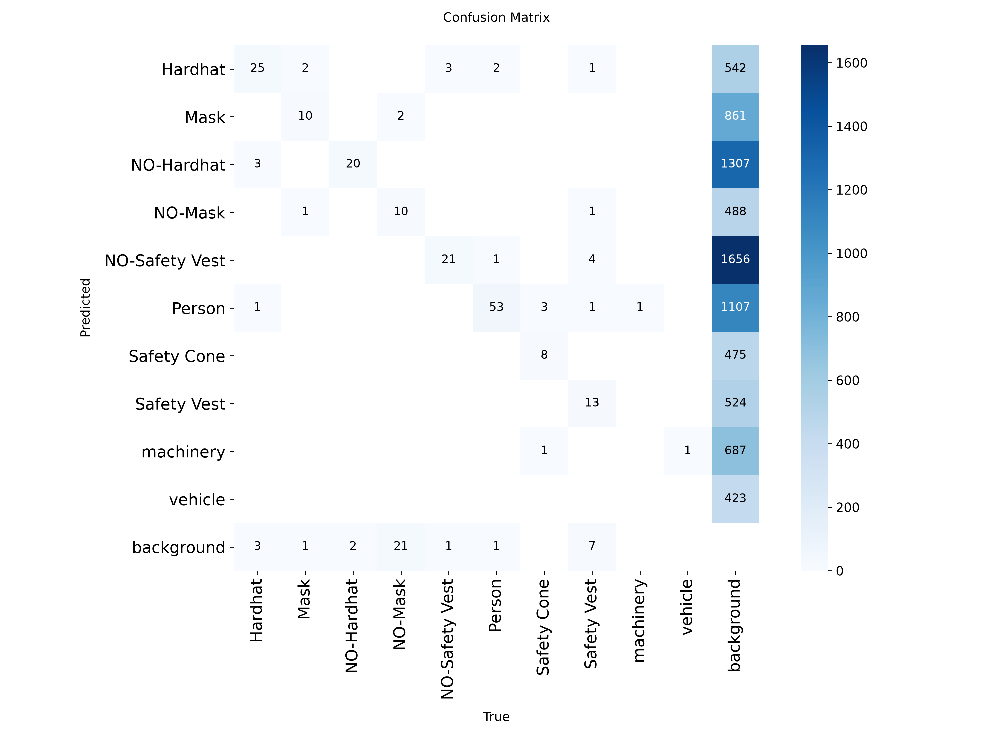

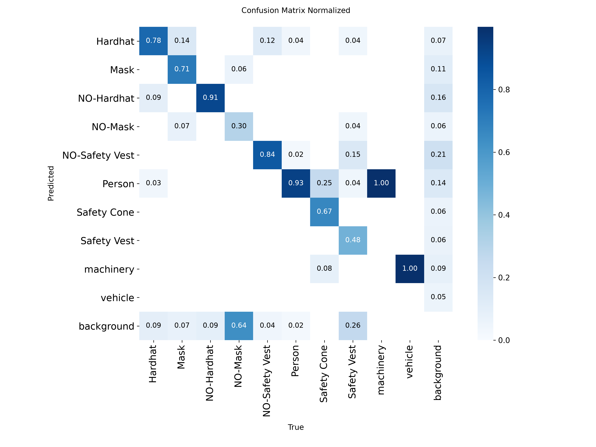
### e2: test по классам

|Класс|Объекты|Precision|Recall|AP50|AP50-95|
|---|---:|---:|---:|---:|---:|
|Hardhat|32|0.7144|0.4691|0.7097|0.4807|
|Mask|14|0.6262|0.3571|0.4430|0.2734|
|NO-Hardhat|22|0.4829|0.6818|0.6188|0.2843|
|NO-Mask|33|0.6819|0.0606|0.1967|0.0633|
|NO-Safety Vest|25|0.3383|0.6000|0.4694|0.2991|
|Person|57|0.6528|0.7368|0.7821|0.5277|
|Safety Cone|12|0.3778|0.2500|0.3203|0.2229|
|Safety Vest|27|0.3723|0.4815|0.3262|0.1763|
|machinery|1|0.0000|0.0000|0.0191|0.0134|
|vehicle|1|0.0000|0.0000|0.0829|0.0580|

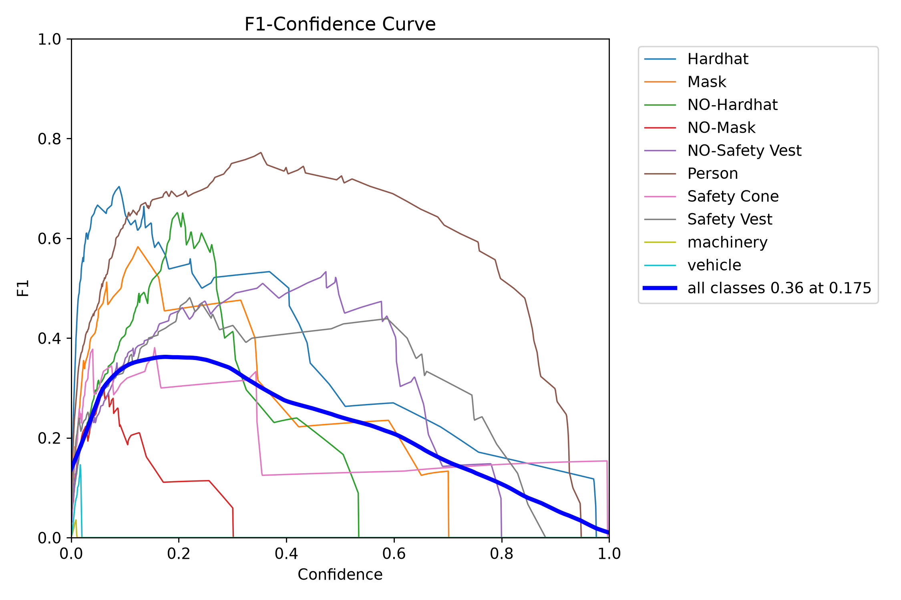

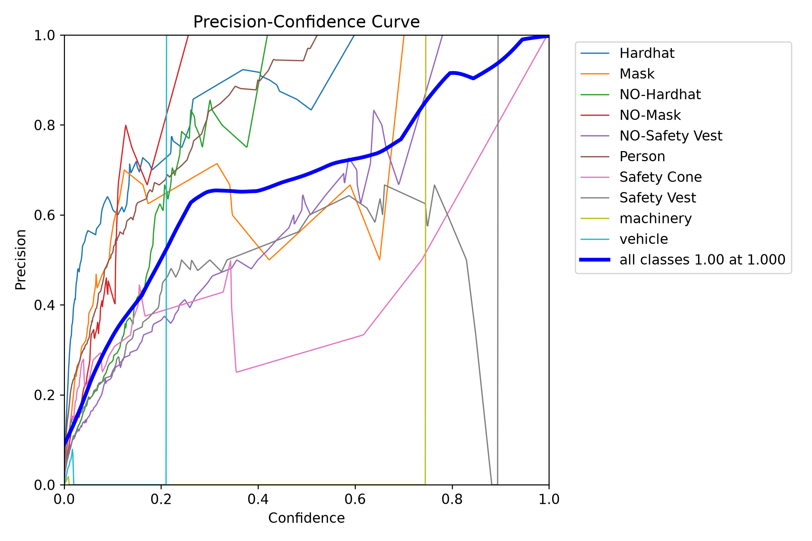

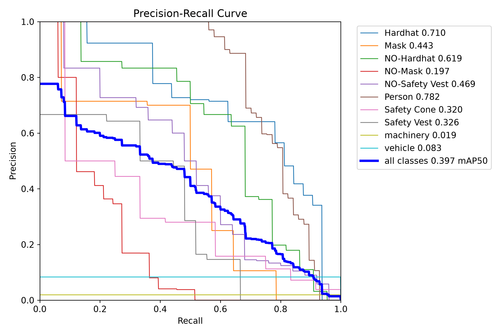

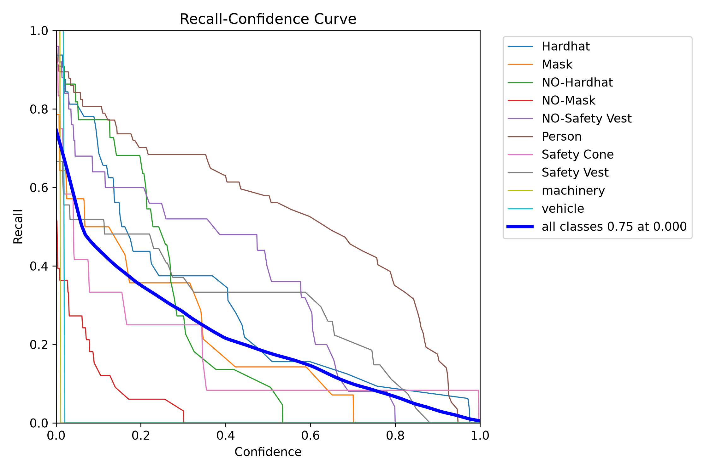

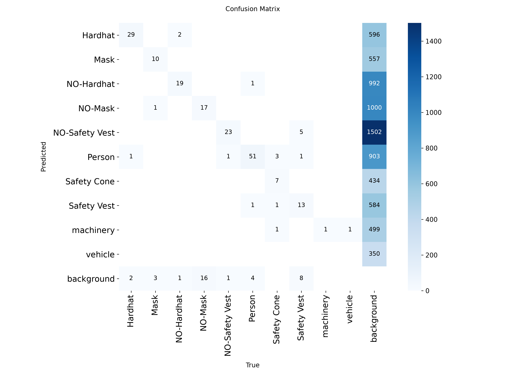

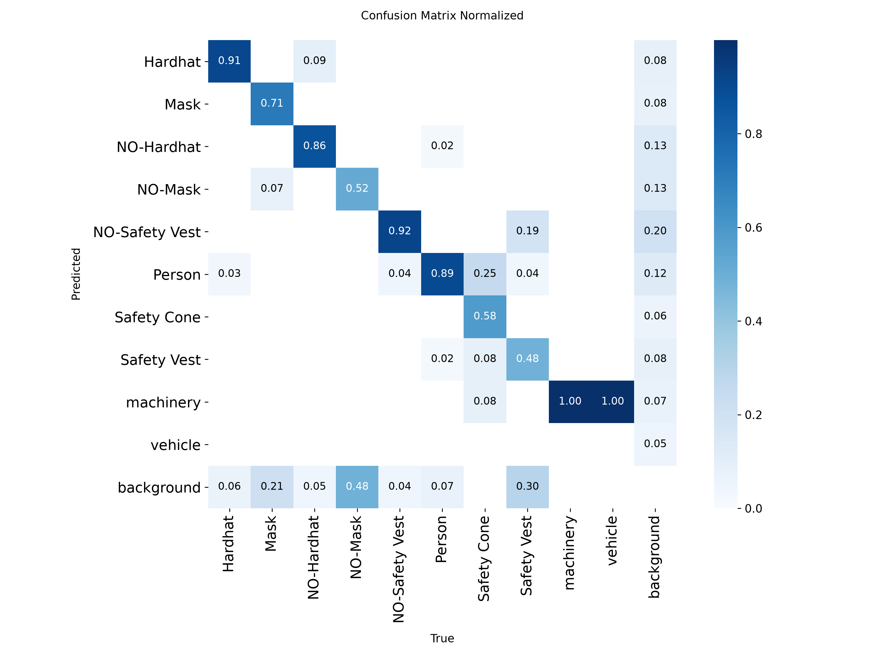

Precision/Recall в таблице Ultralytics соответствуют порогу около максимума среднего F1, а галереи используют фиксированный confidence=.25. Матрица Ultralytics: строки — предсказанный класс, столбцы — истинный; background-столбец — FP, background-строка — FN. Матрица построена при confidence=.001 для официальной оценки: большое число фоновых FP включает очень слабые гипотезы и не равно FP при рабочем .25. AP усредняется по IoU от .50 до .95, mAP — по классам. При одном объекте AP machinery/vehicle не является устойчивой оценкой.

## Полная цепочка обработки

Batch=1, CPU, 3 прогревочных вызова исключены, 28 кадров. Полный вызов включает декодирование, predict и сериализацию рамок; запись галерей исключена. p50=49.15 мс, p95=55.33 мс; 20.10 кадров/с; максимальный наблюдённый RSS=382.5 MB.

|Этап|Среднее, мс|
|---|---:|
|decode_ms|2.478|
|full_ms|49.760|
|preprocess|1.019|
|inference|43.503|
|postprocess|0.749|

Несопоставленных детектов на 100 кадров: 200.0; кадров хотя бы с одним FP на 100: 71.4. Это ошибки относительно исходной разметки, а не число производственных нарушений или тревог конкретной службы.

|Условия|TP|FP|FN|Precision|Recall|
|---|---:|---:|---:|---:|---:|
|normal|97|56|127|0.634|0.433|
|dark|97|49|127|0.664|0.433|
|bright|92|65|132|0.586|0.411|
|occluded|80|55|144|0.593|0.357|

Синтетические изменения освещения и перекрытия не заменяют независимую съёмку. Ракурс оценён качественно в аудите. [Политика отказа, drift и отката](system-policy.md).

## Ошибки и ограничения

Шесть повторно создаваемых галерей находятся в selected/. Высокоуверенный FP без GT — кандидат для проверки разметки, а не доказанная ошибка эталона. Ручной разбор минимум 10 примеров: [анализ ошибок](error-analysis.md). Сопоставление диагностик — greedy по confidence и IoU, официальный AP рассчитывается Ultralytics отдельно.

Ограничения: малый и неоднородный набор, редкие классы, неизвестные реальные ID камер, неоднозначные отрицательные PPE-метки и рамки; один seed не позволяет оценить дисперсию. Модель не допускается к автоматическим санкциям или управлению безопасностью. Следующий эксперимент — расширить независимые сцены и количество редких тестовых объектов, затем повторить опыт с несколькими seed.

## Воспроизведение, проверки и ИИ

[Команды, оборудование и использование ИИ](../README-lab03.md). [Аудит](annotation-audit.md), [проверка соответствия](compliance.md), [подготовка к защите](defense.md). Точные версии — requirements-lock.txt; конфигурации — configs/; commit и SHA256 весов/манифеста — training/*/provenance.json. Результаты получены локальными запусками. Внешняя рецензия, подтверждение студентом ручной проверки и защита требуют участия людей.

Ограничение трассировки E1 и соответствие сохранённого коммита рабочему дереву описаны в [журнале](experiment-plan.md). E2 быстрее E1, но различие качества на одном seed и малом наборе не доказывает общего преимущества заморозки.
