# Отчёт по лабораторной работе № 3

## Промышленная видеоаналитика: обнаружение средств индивидуальной защиты с YOLOv8

**Дисциплина:** «Введение в искусственный интеллект»  
**Выполнила:** Брагина Елизавета
**Год:** 2026

---

## 1. Цель и задачи работы

**Цель работы** — обучить модель обнаружения объектов находить средства индивидуальной защиты (СИЗ) на изображениях, сравнить варианты обучения и оценить качество и скорость полученного решения.

Вход программы — фотография. Выход — прямоугольные рамки вокруг найденных объектов, названия их классов и уверенность модели. Например, на фотографии рабочего программа должна выделить человека, каску и сигнальный жилет.

Для достижения цели выполнены следующие задачи:

1. Изучен исходный проект и подготовлен набор изображений с разметкой.
2. Данные разделены на обучающую, валидационную и тестовую части с учётом похожих сцен.
3. Проверена исходная предобученная модель и проведены три эксперимента обучения YOLOv8n.
4. Рассчитаны метрики, построены графики и проанализированы ошибки.
5. Измерены задержка обработки, потребление памяти и устойчивость к ухудшению изображения.
6. Подготовлены проверки данных, инструкции воспроизведения и материалы для рецензирования.

## 2. Используемый метод

### 2.1. Обнаружение объектов

В отличие от классификации всего изображения, обнаружение объектов определяет **и класс, и положение каждого объекта**. Положение задаётся прямоугольной рамкой. На одном изображении может быть несколько людей и несколько предметов СИЗ.

Использована **YOLOv8n** — небольшой вариант семейства YOLOv8. Начальные веса `yolov8n.pt` предварительно обучены на общих классах объектов COCO. Такое обучение позволяет использовать уже выученные визуальные признаки и затем адаптировать модель к классам лабораторной работы.

**Эпоха** — один проход по обучающей выборке. **Пакет (batch)** — число изображений, обрабатываемых вместе. **Заморозка слоёв** означает, что параметры выбранной части сети не изменяются при обучении. В этой работе проверялось, как заморозка первых 10 слоёв влияет на результат.

Файл `best.pt` содержит checkpoint с лучшим результатом на validation в течение запуска. Файл `last.pt` относится к последней эпохе. Итоговые метрики рассчитывались по `best.pt`; графики обучения показывают историю всех эпох.

### 2.2. Классы объектов

| ID | Название в данных | Смысл |
|---:|---|---|
| 0 | Hardhat | Защитная каска |
| 1 | Mask | Маска на лице |
| 2 | NO-Hardhat | Область головы без каски |
| 3 | NO-Mask | Область лица без маски |
| 4 | NO-Safety Vest | Область торса без сигнального жилета |
| 5 | Person | Человек |
| 6 | Safety Cone | Дорожный конус |
| 7 | Safety Vest | Сигнальный жилет |
| 8 | machinery | Строительная техника |
| 9 | vehicle | Транспорт |

Классы с приставкой `NO-` имеют собственные рамки в исходной разметке. Они **не определяются простым отсутствием положительного предсказания**. Если модель не обнаружила каску, это ещё не доказывает, что человек работает без неё: каска могла быть маленькой, закрытой или пропущенной моделью.

## 3. Подготовка данных

### 3.1. Источник и состав выборки

Использован набор [Construction Site Safety, версия 28](https://universe.roboflow.com/roboflow-universe-projects/construction-site-safety/dataset/28) от Roboflow Universe Projects, полученный через зеркало snehilsanyal на Kaggle. Дата получения — 18 ноября 2026 года. В документации источника указана лицензия **CC BY 4.0**. Контрольные суммы архива и манифеста сохранены в [provenance.json](../data/provenance.json).

Исходный архив содержит 2801 изображение, включая готовые аугментированные варианты. Для небольшого локального эксперимента отобраны **194 изображения с уникальными исходными именами** из первоначальных valid/test. Исходная обучающая часть с готовыми аугментациями исключена, прежнее разбиение не использовалось. Такой выбор сократил время обучения, но ограничил разнообразие данных и достижимое качество модели.

Изображения источником приведены к размеру 640 × 640. Разметка хранится в текстовых файлах формата YOLO: `class_id x_center y_center width height`. Координаты центра, ширина и высота нормированы на размер изображения.

### 3.2. Разбиение без утечки

| Часть | Изображения | Назначение |
|---|---:|---|
| Train | 135 | Обновление параметров модели |
| Validation | 31 | Выбор конфигурации и лучшего checkpoint |
| Test | 28 | Итоговая оценка после выбора между E1 и E2 |

Близкие кадры одного видео не должны попадать в разные части: иначе модель может узнавать знакомую сцену, а оценка будет завышена. Перед разбиением изображения объединены по признакам источника, исходным именам, SHA256, перцептивному хэшу и результатам визуального просмотра. Дополнительные объединения перечислены в [scene-overrides.json](../data/scene-overrides.json).

Реальные идентификаторы камер доступны не для всех изображений. Поэтому часть групп определена консервативно по именам и визуальному сходству. Автоматические проверки подтверждают отсутствие пересечения **зафиксированных** групп, имён и SHA256; они не доказывают полного отсутствия всех неизвестных связей между сценами.

Точный состав выборок зафиксирован в [manifest.json](../data/manifest.json) до обучения. Число объектов каждого класса:

| Класс | Train | Validation | Test |
|---|---|---|---|
| Hardhat | 152 | 3 | 32 |
| Mask | 24 | 11 | 14 |
| NO-Hardhat | 81 | 7 | 22 |
| NO-Mask | 116 | 3 | 33 |
| NO-Safety Vest | 159 | 11 | 25 |
| Person | 259 | 22 | 57 |
| Safety Cone | 123 | 1 | 12 |
| Safety Vest | 70 | 4 | 27 |
| machinery | 40 | 58 | 1 |
| vehicle | 79 | 3 | 1 |

Особенно мало примеров некоторых классов: в validation только три каски и один конус, а в test — по одному объекту техники и транспорта. Метрики таких классов нестабильны и не позволяют делать широкие выводы.

### 3.3. Проверка разметки

Автоматически проверены существование файлов, число полей в строке, допустимость класса, конечность и диапазон координат, положительность размеров рамок и контрольные суммы.

Агентом Codex визуально просмотрены 30 случайных изображений и ещё 10 с малыми объектами. Выявлены неоднозначные рамки, мелкие и перекрытые объекты, неоднородность сцен и спорная граница классов `machinery`/`vehicle`. Наблюдения записаны в [журнале аудита](annotation-audit.md). Разметка не исправлялась по догадкам модели.

**Ограничение выполнения:** этот просмотр не выдан за самостоятельную ручную проверку студентом. Студенту необходимо подтвердить или уточнить замечания по выбранным 40 кадрам.

## 4. Условия и порядок экспериментов

Вычисления выполнены локально на CPU: **Intel Core Ultra 5 125H, 16 ГБ оперативной памяти, Windows**. Использовано 6 вычислительных потоков; загрузка данных — `workers=0`. Точные версии Python и библиотек сохранены в `requirements-lock.txt` и файлах provenance каждого запуска.

Общие настройки обучения: YOLOv8n, изображение 640 × 640, batch=4, seed=42, AdamW, начальная скорость обучения 0,001. Для E1/E2 число эпох уменьшено с 50 до 20, а batch — с 16 до 4 по ресурсным соображениям; решение зафиксировано до сравнения. Позже проведён отдельный опыт E3 на 50 эпох.

| Опыт | Инициализация | Эпохи | Заморозка | Проверяемая задача |
|---|---|---:|---|---|
| E0 | Предобученные веса COCO | — | — | Проверить модель на 10 изображениях без дообучения |
| E1 | Предобученные веса COCO | 20 | Нет | Получить базовое решение |
| E2 | Те же предобученные веса | 20 | Первые 10 слоёв | Проверить влияние заморозки |
| E3 | Те же предобученные веса | 50 | Первые 10 слоёв | Проверить влияние длительности обучения |

Каждый обучающий опыт начинался с исходных весов, а не с результата предыдущего. E2 отличается от E1 фактором заморозки; E3 отличается от E2 числом эпох. При увеличении числа эпох также растягивается встроенное расписание скорости обучения.

Исходный репозиторий содержал готовые веса и результаты, но не исполняемый код обучения. Его `best.pt` проверен на пяти изображениях. Он уже обучался на исходном датасете, поэтому не использован для честного сравнения E1/E2/E3. Результаты E0 и исходного запуска сохранены отдельно.

**Порядок оценки:** сначала по validation выбрана E2 среди E1/E2, затем обе модели оценены на test. E3 проведён позже, после просмотра первого отчёта. Для него использована только validation; test повторно не оценивался. Для независимого подтверждения дальнейших улучшений нужна новая тестовая выборка.

## 5. Метрики качества

Предсказание считается правильным, если класс совпадает и рамка достаточно хорошо соответствует эталону. Степень совпадения задаётся **IoU**:

`IoU = площадь пересечения рамок / площадь их объединения`.

IoU=1 означает полное совпадение, IoU=0 — отсутствие пересечения. Одной эталонной рамке соответствует не более одного правильного предсказания; повторный детект может стать ложным срабатыванием.

| Показатель | Понятное объяснение |
|---|---|
| TP | Правильно обнаруженный объект |
| FP | Лишний или неверный детект |
| FN | Пропущенный размеченный объект |
| Precision | Доля правильных среди выданных предсказаний: TP / (TP + FP) |
| Recall | Доля найденных среди всех размеченных объектов: TP / (TP + FN) |
| AP | Площадь под кривой precision–recall для одного класса |
| mAP@0.5 | Среднее AP по классам при IoU=0,5 |
| mAP@0.5:0.95 | Среднее AP по классам и десяти порогам IoU от 0,50 до 0,95 |

Чем выше mAP, тем лучше. Значение mAP=0,24 **не означает «24% фотографий обработано правильно»**: эта метрика одновременно характеризует ранжирование предсказаний и точность рамок.

В официальной оценке Ultralytics использован низкий порог confidence=0,001 для построения кривых. В диагностических галереях использованы confidence=0,25 и NMS IoU=0,7. Precision/Recall в библиотечной таблице соответствуют порогу около максимума среднего F1, поэтому они могут отличаться от показателей галереи при фиксированном пороге.

## 6. Результаты обучения

### 6.1. Сравнение на validation

| Опыт | mAP@0.5 | mAP@0.5:0.95 | Время запуска обучения, мин |
|---|---|---|---|
| E1 | 0.1851 | 0.0963 | 11.1 |
| E2 | 0.2365 | 0.1209 | 8.6 |
| E3 | 0.2868 | 0.1507 | 18.6 |

E2 улучшил средний результат относительно E1. Более длительное обучение E3 дополнительно увеличило validation mAP@0.5:0.95 с **0,1209 до 0,1507**, то есть на **2,98 процентного пункта**. Однако прирост оказался неодинаковым для разных классов.

### 6.2. Как читать графики обучения

На оси X показаны эпохи. Графики `train/*loss` показывают ошибки на обучающих данных; `val/*loss` — на validation. Для loss желательно снижение. Для precision, recall и mAP желательно увеличение. Снижение train loss при отсутствии улучшения validation может указывать на переобучение.

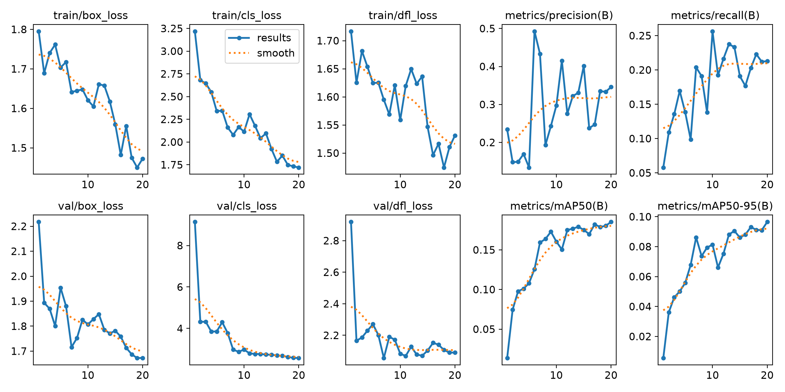

*Рисунок 1 — E1: базовое обучение без заморозки слоёв, 20 эпох.*

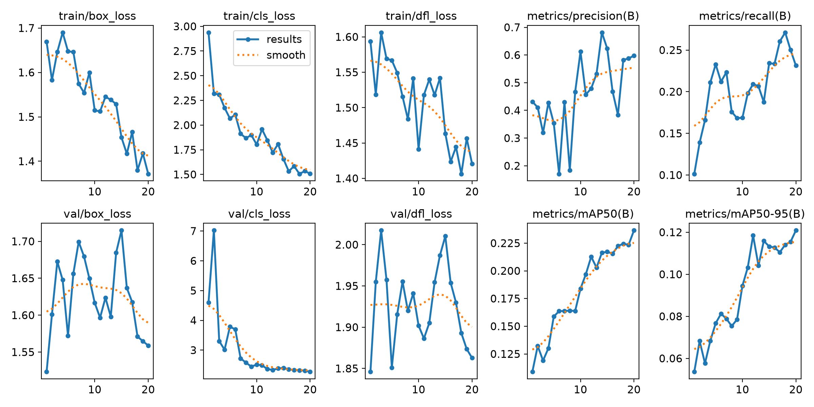

*Рисунок 2 — E2: обучение с заморозкой первых 10 слоёв, 20 эпох.*

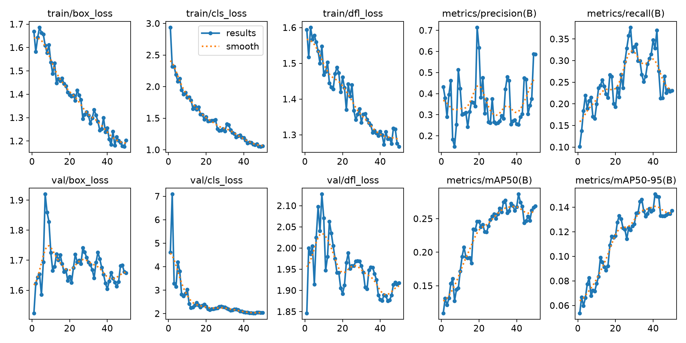

*Рисунок 3 — E3: обучение с заморозкой первых 10 слоёв, 50 эпох. Показаны все эпохи, включая колебания и ухудшения после достижения лучшего результата.*

У E3 обучающие ошибки продолжают снижаться, но validation-метрики колеблются. Лучший checkpoint получен примерно на 41-й эпохе; последняя эпоха не является лучшей. Следовательно, просто увеличивать число эпох без контроля validation недостаточно.

### 6.3. E3: качество лучшего checkpoint на validation

| Класс | Объектов val | AP50–95 E2 | AP50–95 E3 | Precision E3 | Recall E3 |
|---|---|---|---|---|---|
| Hardhat | 3 | 0.0863 | 0.0625 | 0.0343 | 0.1028 |
| Mask | 11 | 0.3210 | 0.4792 | 0.9272 | 0.6364 |
| NO-Hardhat | 7 | 0.0471 | 0.0522 | 0.1363 | 0.2857 |
| NO-Mask | 3 | 0.0005 | 0.0000 | 0.0000 | 0.0000 |
| NO-Safety Vest | 11 | 0.1565 | 0.1317 | 0.3823 | 0.7887 |
| Person | 22 | 0.2823 | 0.2834 | 0.2932 | 0.4545 |
| Safety Cone | 1 | 0.0000 | 0.0000 | 0.0000 | 0.0000 |
| Safety Vest | 4 | 0.0015 | 0.0075 | 0.0000 | 0.0000 |
| machinery | 58 | 0.2761 | 0.2725 | 0.3657 | 0.6552 |
| vehicle | 3 | 0.0376 | 0.2175 | 0.4074 | 0.3333 |

Рост среднего AP обеспечивают прежде всего Mask и vehicle. AP Hardhat снизился с 0,0863 до 0,0625, AP NO-Safety Vest — с 0,1565 до 0,1317. **E3 лучше по средней validation-метрике, но не по всем критичным классам СИЗ.** Малые числа объектов дополнительно ограничивают надёжность сравнения.

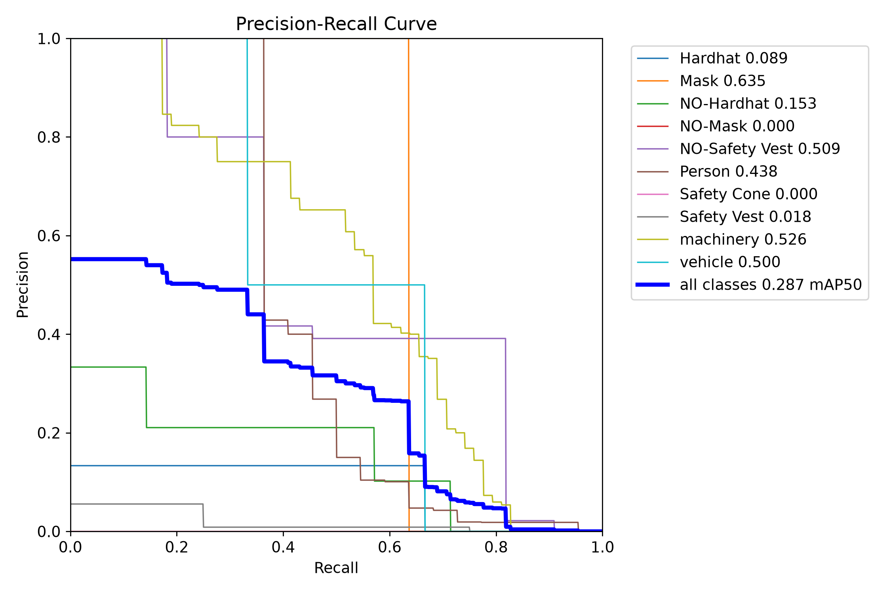

*Рисунок 4 — Precision–recall для лучшей E3 на validation. По горизонтали — полнота, по вертикали — точность. Чем ближе кривая к правому верхнему углу, тем лучше.*

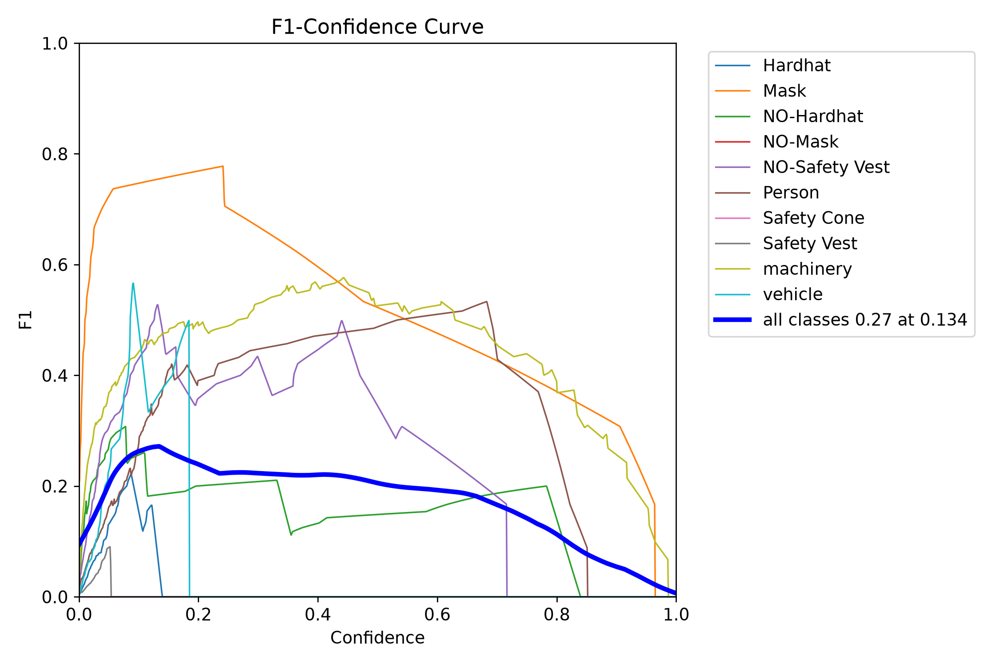

*Рисунок 5 — Зависимость F1 от confidence для E3 на validation. F1 объединяет precision и recall; максимум показывает один из вариантов компромисса между пропусками и лишними детектами.*


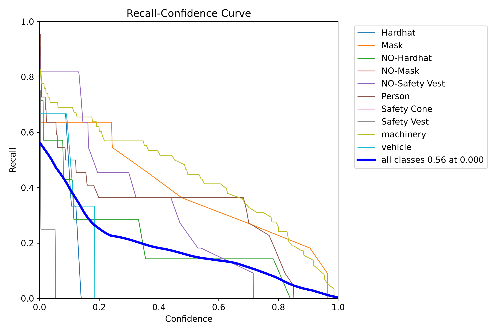

*Рисунок 6 — Recall при разных порогах confidence, E3, validation. Повышение порога обычно исключает слабые предсказания, но увеличивает число пропусков.*

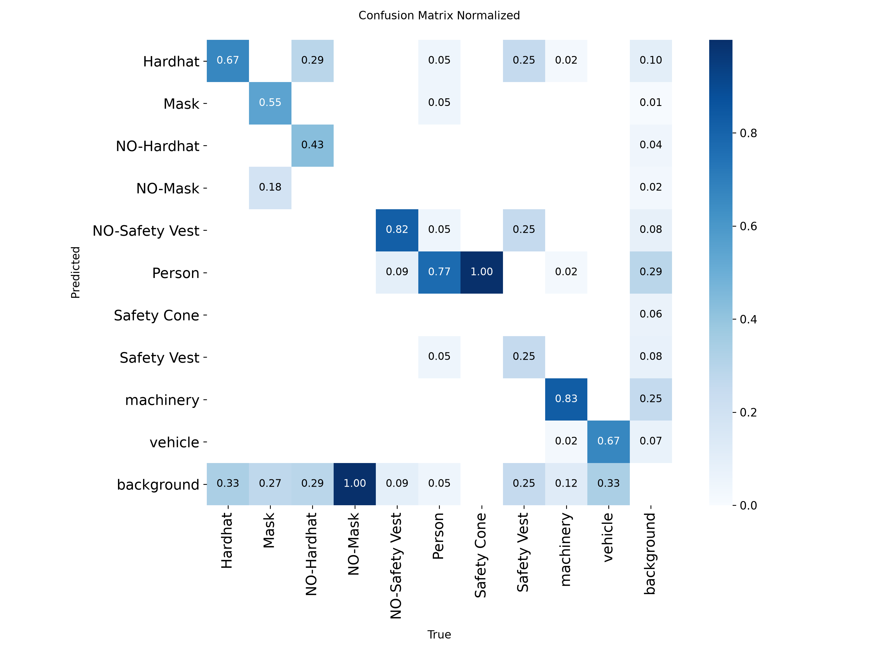

*Рисунок 7 — Нормированная матрица ошибок лучшей E3 на validation. Строки — предсказанные классы, столбцы — истинные. Background-строка соответствует пропускам, background-столбец — ложным срабатываниям. Матрица рассчитана библиотекой при confidence=0,001; она включает слабые гипотезы и не равна диагностике при рабочем пороге 0,25.*

### 6.4. Отдельная итоговая оценка E1/E2 на test

| Опыт | Test mAP@0.5 | Test mAP@0.5:0.95 |
|---|---|---|
| E1 | 0.3882 | 0.2050 |
| E2 | 0.3968 | 0.2399 |

Эти результаты получены на **других изображениях**, чем validation. Более высокие значения test не означают, что модель улучшилась между оценками. Сравнивать E3 validation с E2 test напрямую нельзя. E3 test-оценки в этой работе нет.

**E1: показатели по классам на test**

| Класс | Объектов | Precision | Recall | AP50 | AP50–95 |
|---|---|---|---|---|---|
| Hardhat | 32 | 0.9328 | 0.6562 | 0.7971 | 0.5236 |
| Mask | 14 | 0.3693 | 0.3571 | 0.3624 | 0.2045 |
| NO-Hardhat | 22 | 0.6086 | 0.2273 | 0.5019 | 0.1788 |
| NO-Mask | 33 | 0.6876 | 0.0303 | 0.1221 | 0.0385 |
| NO-Safety Vest | 25 | 0.3713 | 0.5200 | 0.4875 | 0.2025 |
| Person | 57 | 0.7901 | 0.6606 | 0.7827 | 0.4597 |
| Safety Cone | 12 | 0.6657 | 0.1667 | 0.4060 | 0.2426 |
| Safety Vest | 27 | 0.4807 | 0.4074 | 0.4107 | 0.1923 |
| machinery | 1 | 0.0000 | 0.0000 | 0.0000 | 0.0000 |
| vehicle | 1 | 1.0000 | 0.0000 | 0.0113 | 0.0070 |

**E2: показатели по классам на test**

| Класс | Объектов | Precision | Recall | AP50 | AP50–95 |
|---|---|---|---|---|---|
| Hardhat | 32 | 0.7144 | 0.4691 | 0.7097 | 0.4807 |
| Mask | 14 | 0.6262 | 0.3571 | 0.4430 | 0.2734 |
| NO-Hardhat | 22 | 0.4829 | 0.6818 | 0.6188 | 0.2843 |
| NO-Mask | 33 | 0.6819 | 0.0606 | 0.1967 | 0.0633 |
| NO-Safety Vest | 25 | 0.3383 | 0.6000 | 0.4694 | 0.2991 |
| Person | 57 | 0.6528 | 0.7368 | 0.7821 | 0.5277 |
| Safety Cone | 12 | 0.3778 | 0.2500 | 0.3203 | 0.2229 |
| Safety Vest | 27 | 0.3723 | 0.4815 | 0.3262 | 0.1763 |
| machinery | 1 | 0.0000 | 0.0000 | 0.0191 | 0.0134 |
| vehicle | 1 | 0.0000 | 0.0000 | 0.0829 | 0.0580 |


*Рисунок 9 — PR-кривые E2 на test после выбора между E1/E2. Этот график относится к E2, а не к дополнительному опыту E3.*

Полные кривые и матрицы исходных опытов доступны в каталогах [E1 test](metrics/e1-test/) и [E2 test](metrics/e2-test/). Изначально выбранная E2 используется в приведённом ниже анализе ошибок и системных измерениях.

## 7. Анализ ошибок E2

При confidence=0,25 на 28 тестовых изображениях диагностическое сопоставление дало **97 TP, 56 FP и 127 FN**. На некоторых кадрах одновременно присутствуют несколько ошибок.

Созданы шесть повторно формируемых галерей:

1. [Ложные срабатывания с высокой уверенностью](selected/high-confidence-fp/README.md).
2. [Пропуски критичных классов](selected/critical-fn/README.md).
3. [Рамки с низким IoU](selected/low-iou/README.md).
4. [Путаница классов](selected/class-confusion/README.md).
5. [Малые объекты](selected/small-occluded/README.md).
6. [Кандидаты на ошибки эталонной разметки](selected/suspected-label/README.md).

Последняя категория не доказывает ошибку разметки: высокоуверенный несопоставленный детект может быть ошибкой самой модели. Перекрытия оценены визуально, автоматический отбор пятой галереи выполняется по малой площади GT.

### 7.1. Малый объект на сложном фоне


*Рисунок 10 — E2, test, кадр 0. Зелёные рамки — эталон, розовые — предсказания. FP=1, FN=4.*

Свод тоннеля распознан как большая область Person, а маленький работник пропущен. Вероятные причины — масштаб, необычный верхний ракурс и недостаток похожих обучающих сцен.

### 7.2. Затенённое лицо

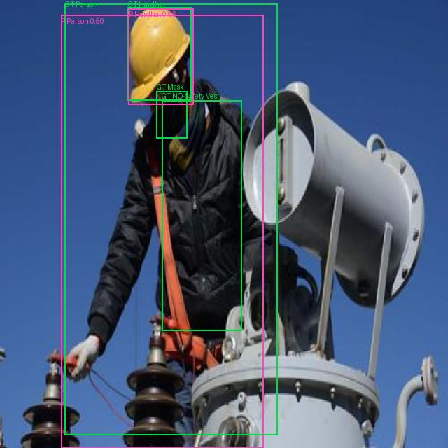

*Рисунок 11 — E2, test, кадр 2. Зелёные рамки — эталон, розовые — предсказания. FP=0, FN=2.*

Человек и каска найдены, но отрицательные классы СИЗ пропущены. Лицо отвернуто и затенено; проверка отрицательной метки по такому изображению неоднозначна.

### 7.3. Съёмка сверху


*Рисунок 12 — E2, test, кадр 3. Зелёные рамки — эталон, розовые — предсказания. FP=0, FN=13.*

Далёкие люди занимают мало пикселей; пропущены 13 размеченных объектов. Следует увеличивать разнообразие дальних сцен и ограничивать автоматические выводы по маленьким головам.

### 7.4. Повторные рамки конусов


*Рисунок 13 — E2, test, кадр 4. Зелёные рамки — эталон, розовые — предсказания. FP=4, FN=3.*

На части конусов выданы дубли, дальние конусы пропущены. Диагностика подтвердила влияние confidence и NMS. Возможную неполноту GT должен проверить человек.

### 7.5. Путаница головных уборов


*Рисунок 14 — E2, test, кадр 5. Зелёные рамки — эталон, розовые — предсказания. FP=1, FN=3.*

Велосипедный шлем принят за строительную каску. Это ошибка классификации и сдвиг предметной области; нужны трудные отрицательные примеры похожих головных уборов.

### 7.6. Предмет у лица

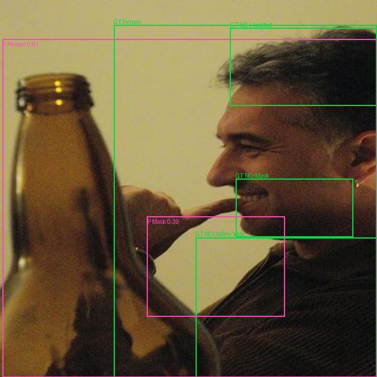

*Рисунок 15 — E2, test, кадр 6. Зелёные рамки — эталон, розовые — предсказания. FP=1, FN=3.*

Рука и бутылка возле лица вызывают ложный детект Mask. Перекрытие и похожая форма затрудняют классификацию; такой случай требует человеческого контроля.

### 7.7. Велосипедист вне строительного домена

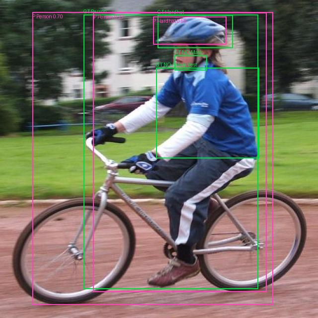

*Рисунок 16 — E2, test, кадр 7. Зелёные рамки — эталон, розовые — предсказания. FP=1, FN=2.*

Человек обнаружен, но модель путает велосипедный шлем с Hardhat и пропускает часть отрицательных СИЗ. Неоднородность датасета влияет на смысл результата.

### 7.8. Пропуск головы без каски


*Рисунок 17 — E2, test, кадр 8. Зелёные рамки — эталон, розовые — предсказания. FP=1, FN=1.*

Маска найдена, NO-Hardhat пропущен, на торсе остаётся лишняя рамка. Понижение порога устраняет FN, но увеличивает FP: одного изменения порога недостаточно.

### 7.9. Дубли и неточная геометрия


*Рисунок 18 — E2, test, кадр 11. Зелёные рамки — эталон, розовые — предсказания. FP=2, FN=0.*

Все GT сопоставлены, но остаются две лишние рамки. Более строгий NMS уменьшает дубли, одновременно создавая пропуск. Требуется баланс на validation.

### 7.10. Наушник вместо каски

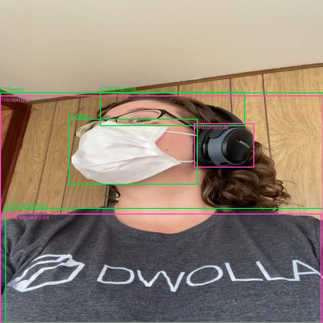

*Рисунок 19 — E2, test, кадр 14. Зелёные рамки — эталон, розовые — предсказания. FP=1, FN=2.*

Наушник распознан как Hardhat, часть объектов на лице пропущена. Похожая форма и профильный ракурс вызывают ошибку модели, которую только NMS не исправляет.

Причины ошибок связаны с малым размером объектов, неоднородными данными, ракурсами и перекрытиями, спорными правилами разметки, ошибками классификации, порогом confidence и подавлением повторных рамок NMS.

В отдельной диагностике на плотной группе людей снижение confidence с 0,25 до 0,1 увеличило TP с 29 до 48, но FP выросли с 19 до 76. Ослабление NMS также увеличивало дубли. Эта проверка выполнена после фиксации модели для объяснения ошибок; основной порог по test не перенастраивался. Подробный разбор 13 кадров и численные результаты находятся в [анализе ошибок](error-analysis.md).

## 8. Скорость и устойчивость системы

### 8.1. Задержка и ресурсы

Измерения относятся к **E2**, CPU, batch=1. Перед замером выполнены три прогревочных вызова. Полный вызов включает декодирование изображения, предсказание и преобразование рамок в выходную структуру. Запись галерей в измеряемый интервал не входит.

| Показатель | Значение |
|---|---|
| Полный вызов, p50 | 49.15 мс |
| Полный вызов, p95 | 55.33 мс |
| Пропускная способность | 20.10 кадра/с |
| Наблюдённый RSS | 382.5 МБ |
| Декодирование, среднее | 2.48 мс |
| Подготовка тензора и размера, среднее | 1.02 мс |
| Нейросеть, среднее | 43.50 мс |
| Последующая обработка, среднее | 0.75 мс |

Медиана p50 означает, что половина кадров обработана не дольше указанного времени. p95 означает, что 95% измеренных вызовов уложились в этот предел. Пропускная способность рассчитана для последовательной обработки изображений; она не является гарантией скорости видеосервиса с очередями и сетью. RSS — максимальное наблюдённое потребление памяти процесса, не гарантированный пик всей системы.

На 100 кадров приходится 200 несопоставленных детектов; хотя бы один FP встречается примерно на 71,4% кадров. Число детектов может превышать число кадров, поскольку на одном изображении бывает несколько ошибок. Это ошибки относительно разметки, а не подтверждённые производственные нарушения.

### 8.2. Проверка ухудшения изображения

| Условия | TP | FP | FN | Precision | Recall |
|---|---|---|---|---|---|
| Исходные изображения | 97 | 56 | 127 | 0.634 | 0.433 |
| Затемнение | 97 | 49 | 127 | 0.664 | 0.433 |
| Осветление | 92 | 65 | 132 | 0.586 | 0.411 |
| Искусственное перекрытие | 80 | 55 | 144 | 0.593 | 0.357 |

Для затемнения яркость умножена на 0,5, для осветления — на 1,5. Перекрытие имитировалось серым прямоугольником в центре размером 20% ширины и 30% высоты. Исходные GT сохранялись, поэтому проверка показывает потерю обнаружений при ухудшении входа. Наиболее заметно снизилась полнота при перекрытии: примерно с 0,433 до 0,357.

Это синтетический стресс-тест. Он не заменяет съёмку на других камерах. Влияние ракурса рассмотрено качественно при аудите верхних, наклонных и боковых видов; отдельный причинный эксперимент с ракурсом не проведён.

## 9. Ограничения и правила использования

Модель является учебным прототипом. Она не должна самостоятельно разрешать опасные работы или назначать санкции. Если голова перекрыта, объект слишком мал, изображение тёмное или предсказания противоречат друг другу, случай следует передавать оператору.

Для контроля изменения условий следует отслеживать яркость кадров, размеры объектов, частоту обнаружений и отмены решений оператором. Новая камера требует отдельной проверки. При ухудшении качества предусматривается возврат к ранее проверенным весам вместе с их конфигурацией и контрольной суммой. Подробная схема приведена в [системной политике](system-policy.md).

Основные ограничения эксперимента:

- 135 обучающих изображений недостаточно для устойчивого покрытия всех условий десяти классов.
- Вместе используются строительные сцены, домашние фотографии с масками, автодромы и фоновые изображения.
- Для ряда классов в validation/test слишком мало объектов.
- Часть разметки неоднозначна; реальные камеры и группы известны не полностью.
- Каждый опыт выполнен с одним seed, поэтому разброс результатов между запусками не оценён.
- E3 выбран по уже используемой validation; новое независимое test-подтверждение отсутствует.

## 10. Проверки и воспроизводимость

Пройдены 14 автоматических тестов: корректность разметки и координат, отсутствие пересечения групп/имён/хэшей, целостность набора, размер визуализации, схема вывода модели, обработка повторных и неверно классифицированных рамок, согласованность настроек E1/E2. Также выполнены Ruff и проверка зависимостей.

| Файл или каталог | Назначение |
|---|---|
| `configs/` | Параметры данных и экспериментов |
| `data/manifest.json` | Точный состав выборок и контрольные суммы |
| `src/ppe/cli.py` | Обучение, оценка и предсказания |
| `src/ppe/data.py` | Проверка данных |
| `src/ppe/vision.py` | Рамки и диагностическое сопоставление |
| `src/ppe/analyze.py` | Галереи и системные измерения |
| `tests/` | Автоматические тесты |
| `runs/` | Локальные веса и журналы запусков |
| `reports/` | Таблицы, графики и выводы |

Полные команды установки и запуска приведены в [README-lab03.md](../README-lab03.md). Для быстрой проверки подготовленного окружения:

```powershell
.\.venv\Scripts\python.exe -m ppe.cli validate-data
.\.venv\Scripts\python.exe -m pytest -q
```

Планы опытов зафиксированы в [основном журнале](experiment-plan.md) и [плане E3](improvement-plan.md). В provenance сохранены версии, конфигурации, commit и SHA256 весов/манифеста. Ограничение трассировки E1: код был в рабочем дереве в момент начала обучения и закоммичен позже; это явно описано в журнале, а commit начала запуска не выдаётся за полный снимок реализации.

Работа опубликована в [форке](https://github.com/LizynBr/Construction-Site-Safety-PPE-Detection), ветка `lab/03-ppe`, [PR №2](https://github.com/LizynBr/Construction-Site-Safety-PPE-Detection/pull/2). Независимая рецензия и приёмка пока не подтверждены; PR не слит, тег приёмки не поставлен.

## 11. Использование ИИ

Codex использован для подготовки кода, тестов, экспериментов, визуального просмотра и черновика отчёта. Основной запрос: выполнить локально лабораторную по двум предоставленным инструкциям, создать форк исходного проекта и проверять соответствие требованиям.

Приняты решения о групповом разбиении, хэшировании и автоматических проверках. Изменены исходные пути Kaggle и ресурсные настройки. Использование уже обученного upstream `best.pt` для инициализации сравниваемых моделей отклонено, поскольку он обучался на том же наборе.

Предложения проверялись тестами, кодом установленной библиотеки, реальными запусками и просмотром графиков. В частности, исправлена несовместимость API сохранения метрик. Риски связаны с ошибками кода и разметки, происхождением составных изображений, малой выборкой и остаточной утечкой сцен. Секреты доступа не включены в репозиторий. Журнал самопроверки — [code-review.md](code-review.md); он не заменяет независимого рецензента.

## 12. Выводы

В работе подготовлен воспроизводимый конвейер обнаружения СИЗ: данные и разбиение зафиксированы, выполнены E0/E1/E2 и дополнительный E3, рассчитаны метрики и системные показатели, создан инструмент анализа ошибок.

Среди исходных E1/E2 по validation выбрана E2. На test её mAP@0.5:0.95 составил **0,2399**. Дополнительный E3 повысил средний validation mAP@0.5:0.95 с **0,1209 до 0,1507**, но ухудшил AP некоторых критичных классов, включая каски. Следовательно, гипотеза пользы более длительного обучения подтверждена для средней validation-метрики, но не для всех классов.

На выбранном устройстве полный вызов E2 занимает около **49 мс по медиане**, однако скорость не компенсирует большое число пропусков и ложных срабатываний. Качество недостаточно для самостоятельных решений о безопасности.

Следующий шаг — расширить набор независимыми строительными сценами, уточнить разметку отрицательных классов, обеспечить достаточное число объектов каждого класса в validation и новой test-выборке, затем повторить сравнение с несколькими seed. Для завершения учебной сдачи остаются самостоятельный аудит студентом, независимая рецензия и устная защита.

## Источники

1. [Исходный проект snehilsanyal](https://github.com/snehilsanyal/Construction-Site-Safety-PPE-Detection).
2. [Construction Site Safety v28](https://universe.roboflow.com/roboflow-universe-projects/construction-site-safety/dataset/28).
