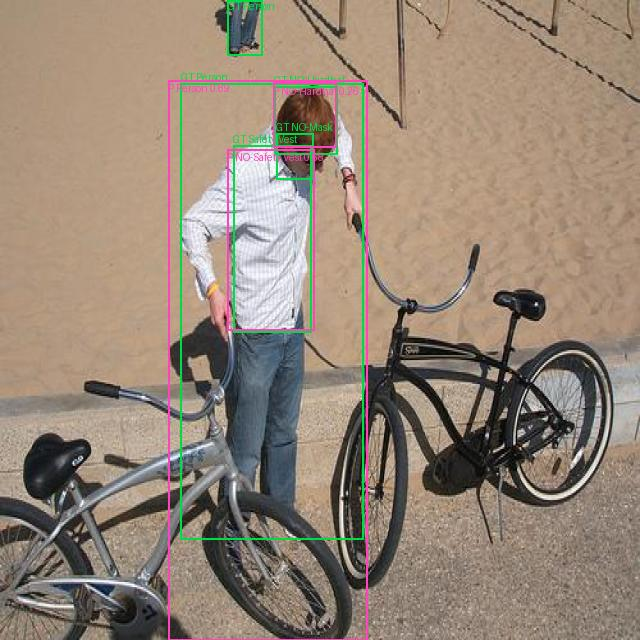
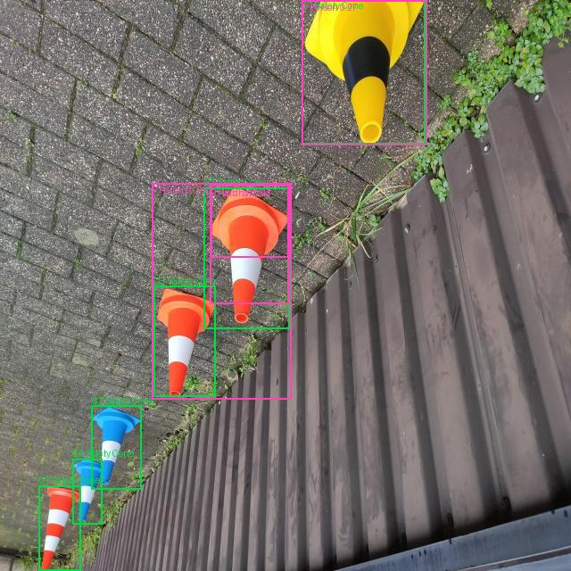
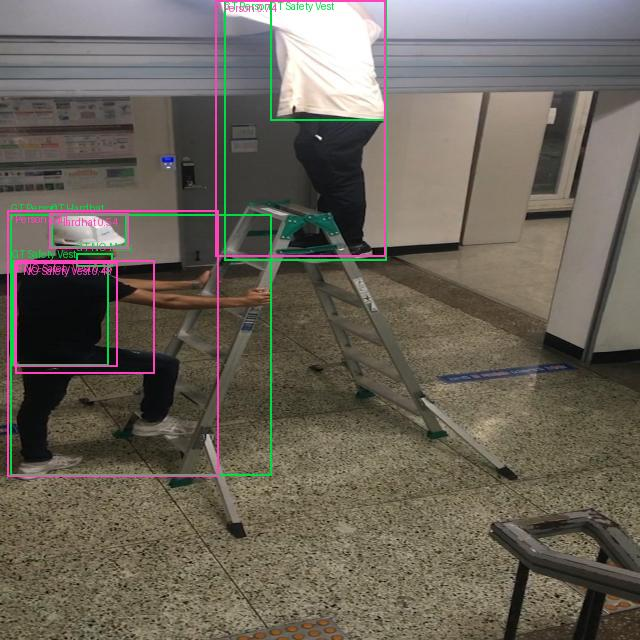
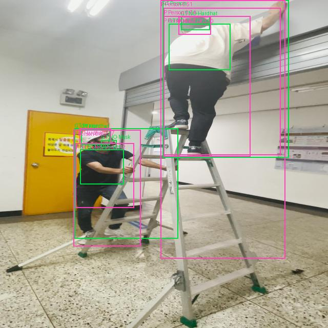

# class-confusion

Green: ground truth. Magenta: prediction. Diagnostic matching: IoU=.5, confidence=.25.

2008_008320_jpg — FP=1, FN=3

IMG_5846_jpg — FP=19, FN=55

MariusConePic31_png_jpg — FP=4, FN=6

class1_077_jpg — FP=2, FN=3

class1_150_jpg — FP=4, FN=4

