# critical-fn

Green: ground truth. Magenta: prediction. Diagnostic matching: IoU=.5, confidence=.25.

-4405-_png_jpg — FP=1, FN=4

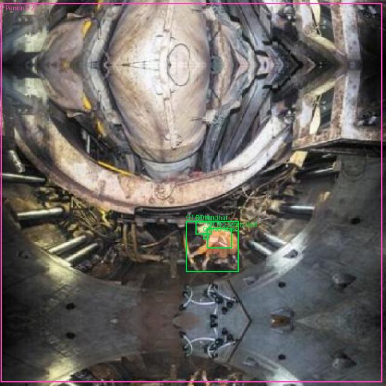

005559_jpg — FP=0, FN=2

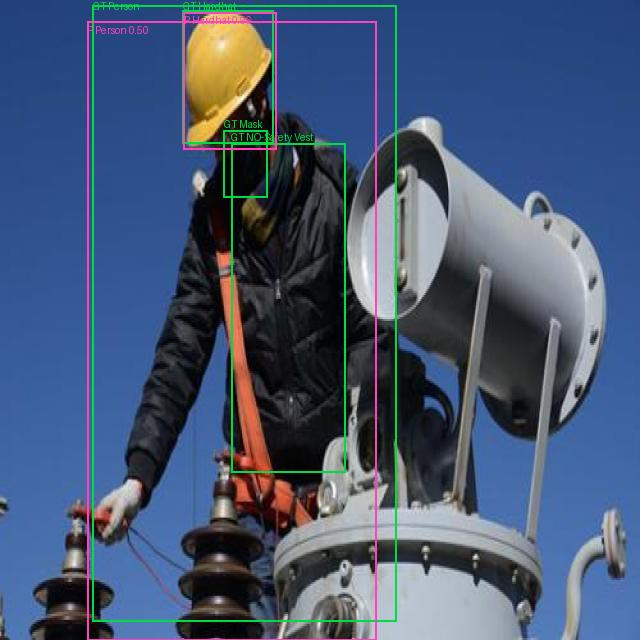

0_jpg — FP=0, FN=13

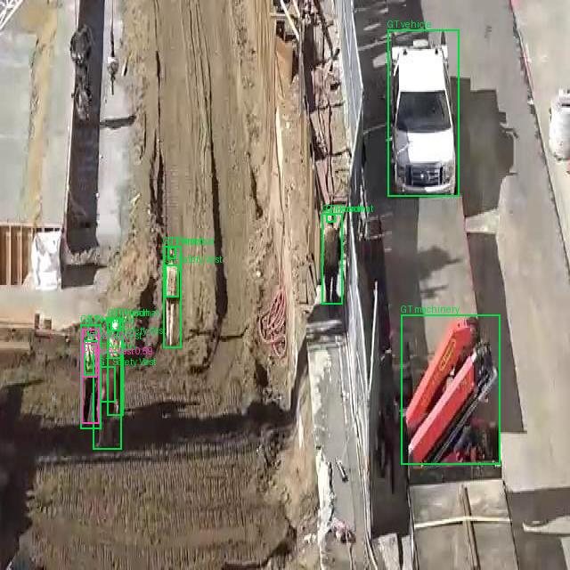

2008_008320_jpg — FP=1, FN=3

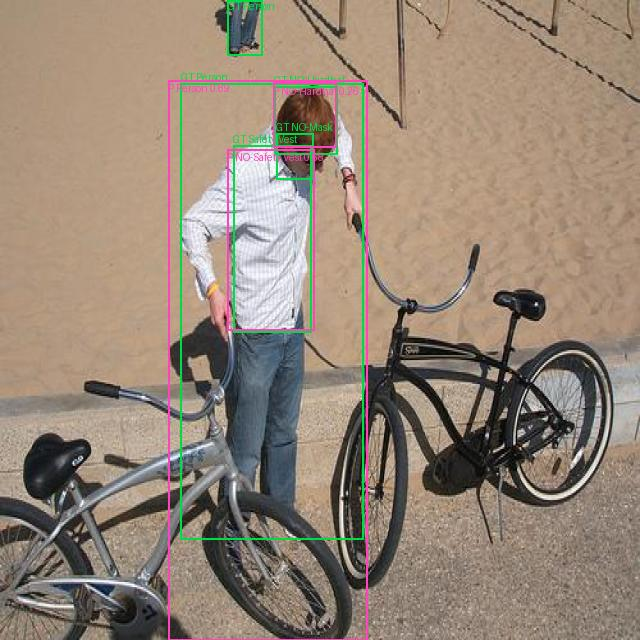

2009_000277_jpg — FP=1, FN=3

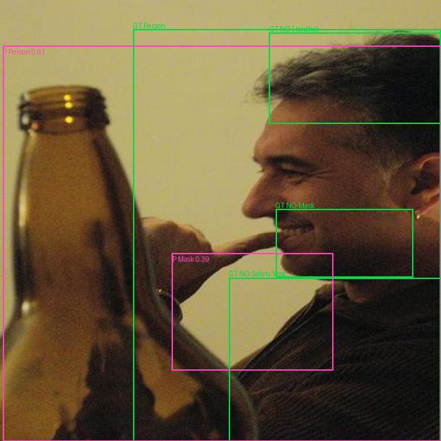

2009_000461_jpg — FP=1, FN=2

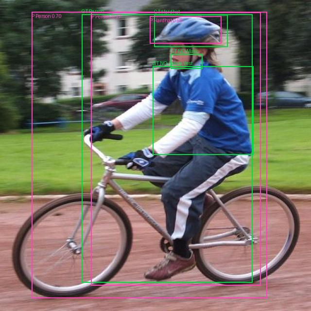

IMG_3093_mp4-22_jpg — FP=1, FN=1

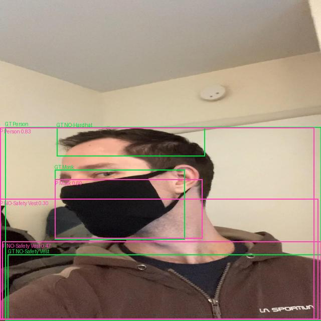

IMG_3100_mp4-12_jpg — FP=0, FN=2

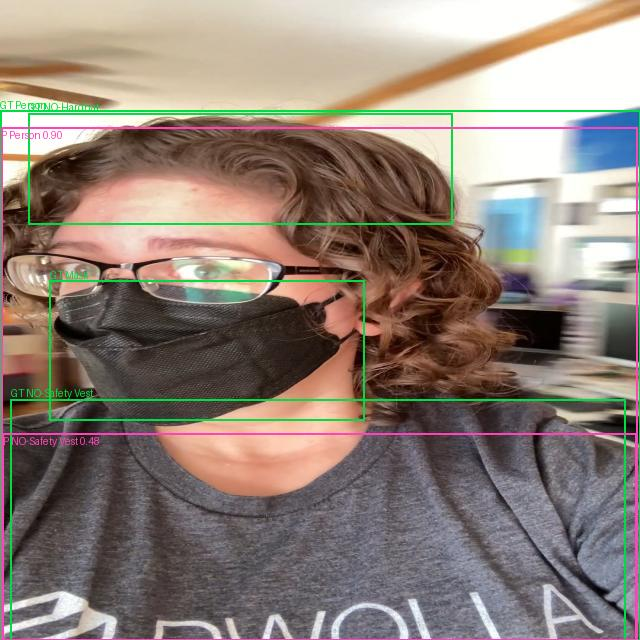

IMG_3100_mp4-3_jpg — FP=1, FN=1

IMG_3103_mp4-16_jpg — FP=1, FN=2

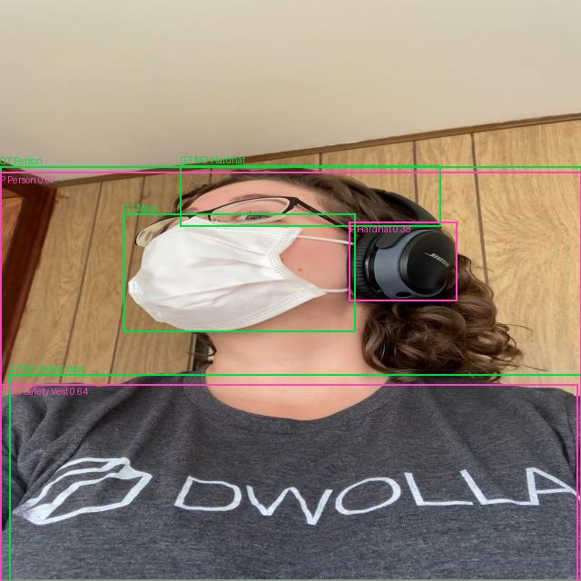

IMG_3103_mp4-17_jpg — FP=1, FN=1

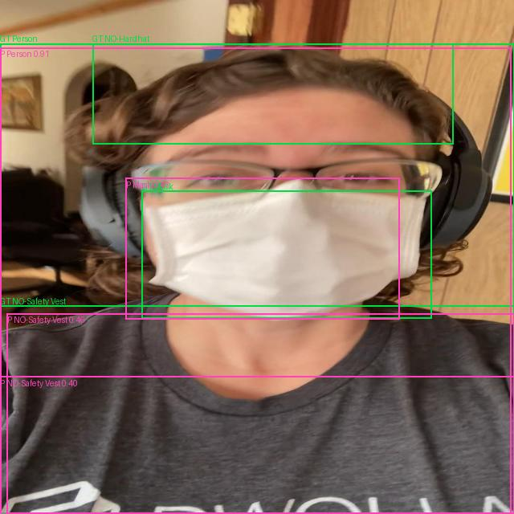

IMG_3103_mp4-8_jpg — FP=0, FN=2

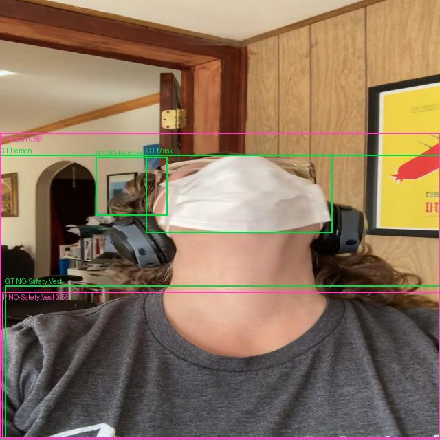

IMG_5846_jpg — FP=19, FN=55

class1_077_jpg — FP=2, FN=3

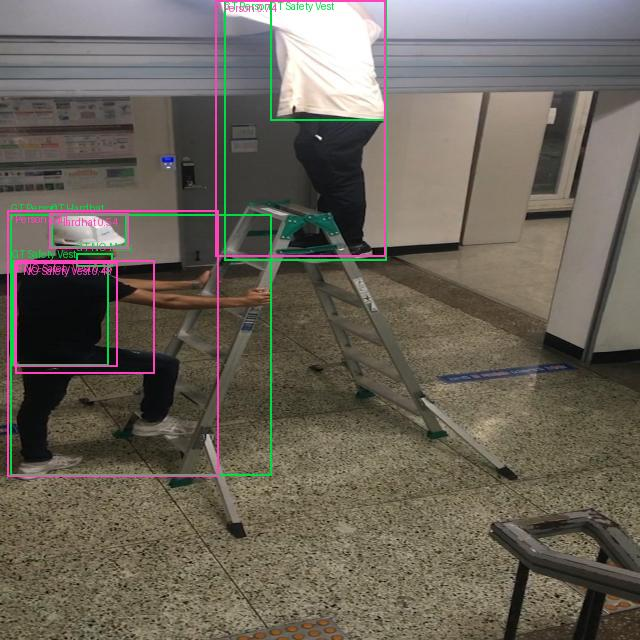

class1_150_jpg — FP=4, FN=4

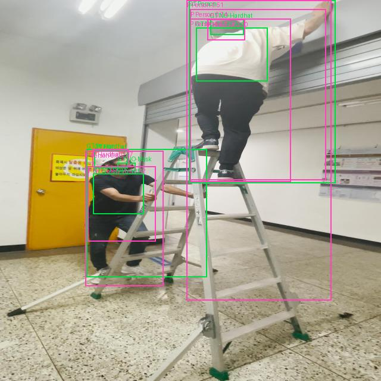

class2_131_jpg — FP=0, FN=3

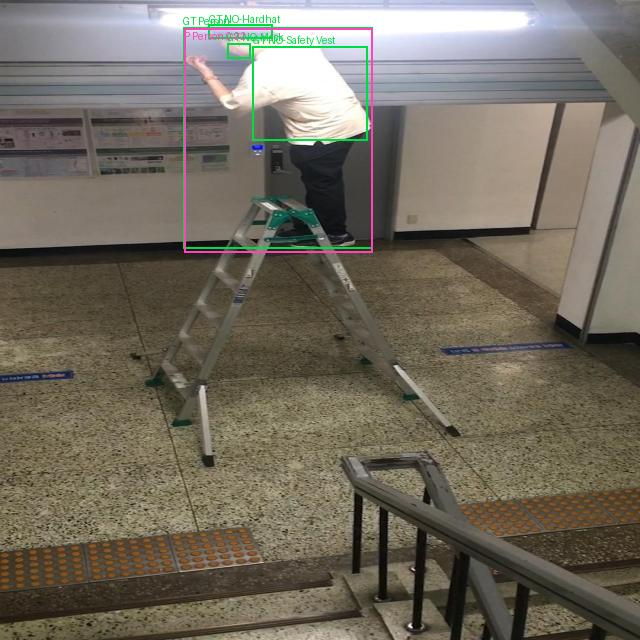

class2_145_jpg — FP=2, FN=5

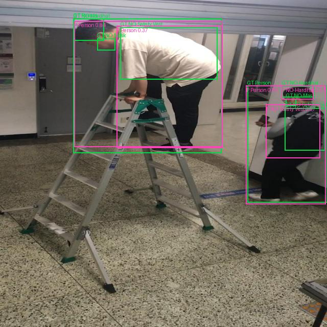

soooo_jpg — FP=5, FN=10

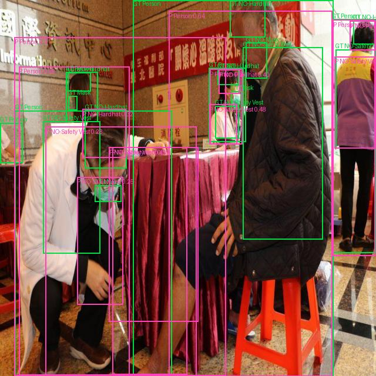