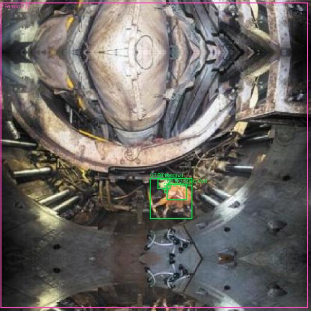
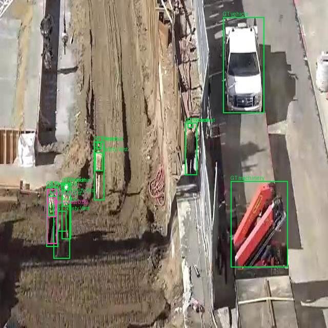
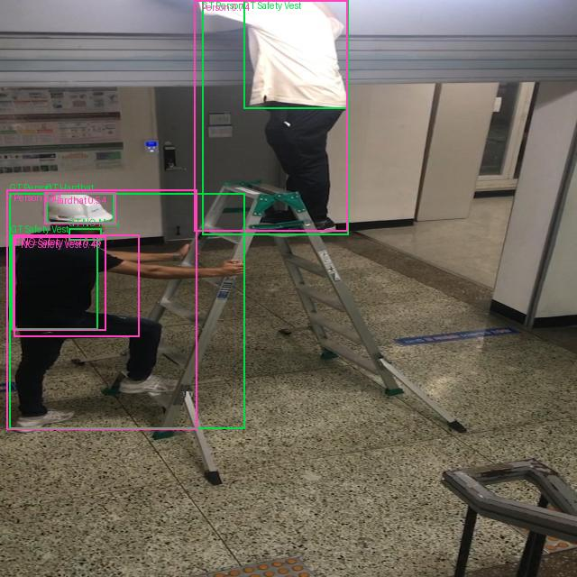
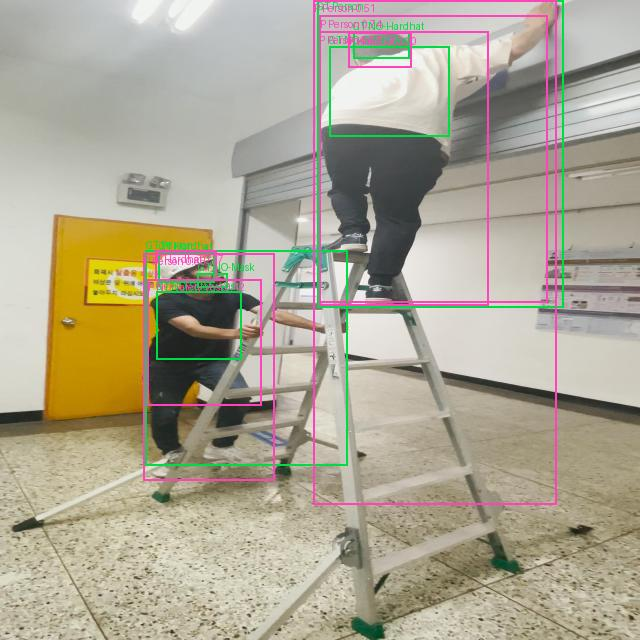
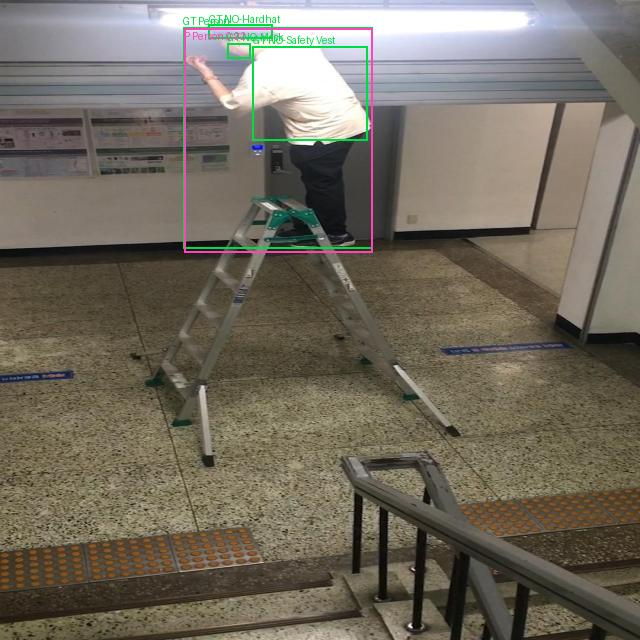
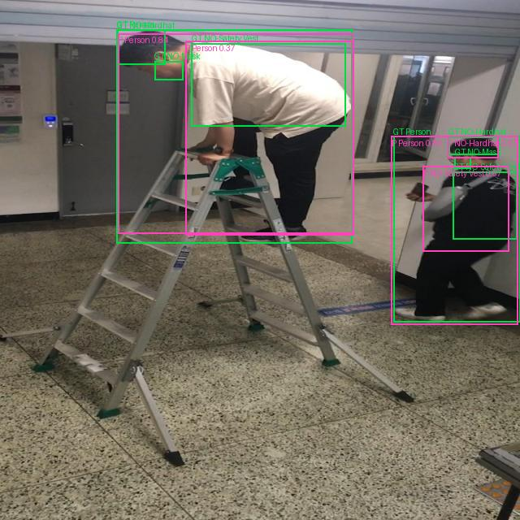
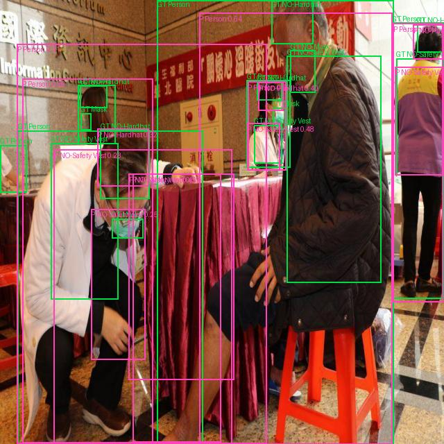

# small-occluded

Green: ground truth. Magenta: prediction. Diagnostic matching: IoU=.5, confidence=.25.

-4405-_png_jpg — FP=1, FN=4

0_jpg — FP=0, FN=13

IMG_5846_jpg — FP=19, FN=55

class1_077_jpg — FP=2, FN=3

class1_150_jpg — FP=4, FN=4

class2_131_jpg — FP=0, FN=3

class2_145_jpg — FP=2, FN=5

soooo_jpg — FP=5, FN=10

